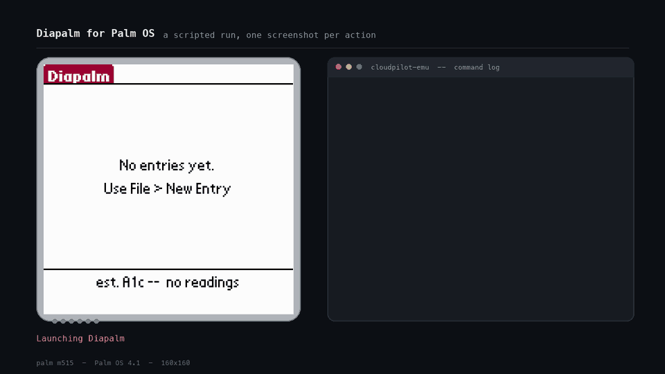

# Diapalm for Palm OS

A 68K Palm OS diabetes diary, inspired by
[Diaguard](https://github.com/Faltenreich/Diaguard) for Android. Log blood
sugar, insulin and carbs, browse the log, and export it as CSV that any PDB
tool can read.

Built for classic Palm OS (68K, Palm OS 3.5+ / Garnet). Developed and tested
against [CloudpilotEmu](https://cloudpilot-emu.github.io/) — the native build
(`cloudpilot-emu`) driven headlessly with a Palm OS 4.1 / Palm m515 ROM. The
browser app runs the same emulator core, so the PRC behaves identically there.



Every frame above is the device's own output, captured during one scripted run
of a test-harness script (kept outside this repo) — no mock-ups. The Palm
screen is on the left and the commands driving it on the right, so you can see
each tap and the screen it produces.

## What it does

- **Log an entry** — timestamp, blood sugar (mg/dL), insulin (units), meal
  carbs (g), and a free-text note. Any numeric field may be left blank; the
  note alone is a valid entry.
- **Entry list** — newest first, one row per entry.
- **Edit / delete** — tap a row to open it, or use the Entry menu. Deleting
  asks for confirmation.
- **A1c estimate** — an `est. A1c` line on the list screen, computed from the
  last 90 days of blood sugar readings, plus a form that also takes a lab A1c
  value by hand and keeps the ones you enter as a history.
- **CSV export** — writes a `Diapalm Export` database you can pull off the
  device and read on a desktop.
- **Reminder** — one pending "log a reading" alarm. Firing it opens a fresh
  entry form pre-filled with the current time.

Out of scope: food database, graphs, statistics, tags, multiple
languages, unit customization, PDF export.

## Layout

```
Makefile          build rules (adapted from palm-toolchain's hello-world)
linker.lkr        link script for the 68K code resource
src/
  startup.c       PilotMain entry stub from the toolchain example
  diapalm.h       DiapalmEntry record, FourCCs, shared state
  app.c           PilotMain, launch codes, event loop, menu, form navigation
  state.c         per-launch state chunk
  dpentry.c/.h    database lifecycle, record CRUD, sort, formatting
  dplist.c/.h     ListForm
  dpedit.c/.h     New/Edit form
  dpa1c.c/.h      A1c estimate, lab value history, A1c form
  dpexport.c/.h   CSV export database
  dpalarm.c/.h    reminder set / cancel / fire
resources/
  resource.h      IDs shared by app.rcp and the C sources
  app.rcp         menu bar, forms, alerts, strings (PilRC)
tools/
  validate-prc.mjs  checks the built PRC's type, creator and resources
docs/
  demo.gif        scripted run of the app (embedded above)
  ORIGINAL-*.md   the pre-code plan and feasibility note, kept for history
DEBRIEF.md        retrospective: what was built, the hard bugs, what's verified
build/            gitignored
```

Source modules are `dp`-prefixed on purpose: a header named `list.h` or
`edit.h` would shadow the SDK's `List.h` / `Edit.h` on a case-insensitive
filesystem.

## One-time setup

The build needs the [palm-toolchain](https://github.com/palmsnipe/palm-toolchain)
(m68k compiler, PilRC, build-prc) and a Palm OS SDK.

```sh
git clone https://github.com/palmsnipe/palm-toolchain.git ~/palm/palm-toolchain
cd ~/palm/palm-toolchain
brew bundle
make setup          # or: make bootstrap
```

Then install the SDK headers into the toolchain prefix:

```sh
~/palm/palm-toolchain/.toolchain/prefix/palmdev/sdk/include
```

SDK 5r4 (Garnet) is what this app was built against — see
[PalmDB](https://palmdb.net/app/palm-os-sdk) or
[archive.org](https://archive.org/download/palm-os-sdk). Reduced GitHub
mirrors often lack `Core/System/PdbMgr.h` and `Core/UI/Dialog.h`.

If the toolchain lives somewhere else, override the root:

```sh
make PALM_TOOLCHAIN_ROOT=/path/to/palm-toolchain
```

`PALM_TOOLCHAIN_PREFIX` overrides just the prefix directory.

## Build

```sh
make          # -> build/Diapalm.prc
make test     # validates type, creator and resource set in the PRC
make clean
```

The link is two-stage: `generate-m68k-relocs.mjs` scans the first link's
relocations and emits an assembly file pinning the 68K trap addresses, which
the second link consumes. Skipping that step produces a PRC that crashes on
launch.

## Run it

Download `Diapalm.prc` from the
[Releases page](https://github.com/syserr/diapalm/releases), or build it
yourself (above) to get `build/Diapalm.prc`. Install it on a device or in an
emulator.

**CloudpilotEmu** (browser): open the web app, pick a 68K ROM such as Palm OS
4.1 on a Palm m515, then drag the PRC onto the emulator window. It appears in
the launcher as **Diapalm**.

## Using the app

Menu bar (tap the top-left corner, or use the hardware menu button):

| Menu | Item | Notes |
| --- | --- | --- |
| File | New Entry | Opens a blank entry form |
| File | Export CSV... | Rewrites `Diapalm Export`, then reports the row count |
| File | A1c... | Opens the A1c form (also opened by tapping the A1c line) |
| Entry | Edit... | Opens the selected entry |
| Entry | Delete | Deletes the selected entry, with confirmation |
| Remind | Set Reminder... | Picks a time; today, or tomorrow if it has passed |
| Remind | Cancel Reminder | Shown only while an alarm is pending |
| Help | About Diapalm | Version info |

Buttons on the entry form are **Cancel**, **Delete** (deletes the open entry,
after confirmation; does nothing in New mode) and **OK**.

Numbers are whole values — blood sugar in mg/dL, carbs in grams, insulin in
units. A decimal point in the insulin field is read as tenths, so `2.5` means
2.5 units.

## A1c

An `est. A1c` line is drawn under the list, so the number is on screen the
moment the app opens. It comes from the same regression the Android app uses
(`0.031 x mg/dL + 2.393`) over the last 90 days of readings, done in integer
math — the 68K has no FPU. Tap the line, or use File → A1c..., to open the
form, which shows the estimate, the average and reading count behind it, and
the newest lab value.

A lab A1c can be typed in by hand with its own date. That value is stored in a
separate `Diapalm A1c` database (type `a1cl`, creator `dprd`) as an
accumulating history — every value you enter stays listed, and the form's
Delete button removes one. A lab value takes over the display for 30 days
after its date, matching the Android app's freshness rule; past that the
estimate shows again and the stale value stays visible on the form marked as a
lab result. The `est.` / `lab` marker is always present so a hand-entered
number is never mistaken for a computed one.

Lab values are stored 8 bytes each, deliberately not as a field on the diary
record: that record is pinned at 132 bytes by a compile-time check.

## CSV export

File → Export CSV... deletes and rebuilds a database named `Diapalm Export`
(type `DIEX`, creator `dprd`) so repeated exports replace rather than
accumulate. Record 0 is the header:

```
datetime_iso,glucose_mgdl,insulin_units,carbs_g,note
2026-10-17T08:30:00,123,2.5,40,"Ate pancakes"
```

Rows are in ascending timestamp order. Unrecorded numbers are empty fields.
The note is always double-quoted, with embedded quotes doubled.

To get the file off a device, hotsync or beam it (any PDB-aware tool will do),
or in CloudpilotEmu use *Save backup* and unzip the resulting archive.

## Storage

Entries live in a database named `Diapalm` (type `diap`, creator `dprd`), one
fixed-size 132-byte record per entry. Records are kept sorted oldest-first by
`timestamp` so display can walk the list backwards and backdated entries
insert into the right place. Lab A1c values live in a second database,
`Diapalm A1c` (type `a1cl`, creator `dprd`), 8 bytes per record. Nothing is
stored on the heap between launches.

## Known limitations

- Two entries saved in the same second have no defined order between them.
- Timestamps are stored as raw seconds, so data survives past 2031; only the
  7-bit year *display* in some Palm date dialogs does not.
- **A reset drops a pending reminder.** Palm keeps the alarm table on the
  dynamic heap, so it survives neither a soft reset nor a clock change; apps
  are expected to re-submit their alarms when they get
  `sysAppLaunchCmdSystemReset` or `sysAppLaunchCmdTimeChange`. This app does
  not handle either launch code yet, so a reminder set before a reset is
  silently lost. Logged entries are unaffected.

## How it was made

Most of this project was vibe coded: written with an AI coding assistant
(Claude Code) from plain-language direction, rather than hand-written line by
line. The C source, resource file, Makefile and docs were all produced that
way, and testing was done by driving the built app through a Palm OS emulator.
Treat it accordingly. It works in the emulator, but it hasn't been audited, and
it hasn't been run on real hardware.

This is a hobby project, not a medical device. Don't rely on it, or on its
A1c estimate, for treatment decisions. `DEBRIEF.md` has the full story of how
the build went.

## License

Copyright (C) 2026 Scott Serr. Diapalm is free software, released under the
[GNU General Public License v3.0](LICENSE) or, at your option, any later
version. It comes with no warranty.

Diapalm is inspired by [Diaguard](https://github.com/Faltenreich/Diaguard) but
contains none of its code.
